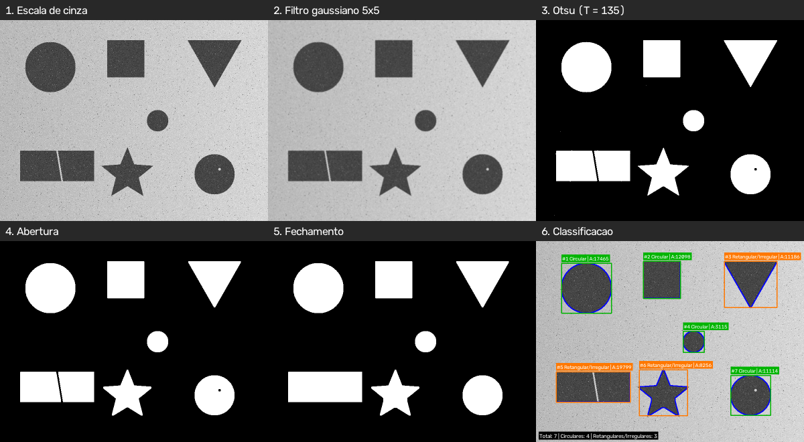
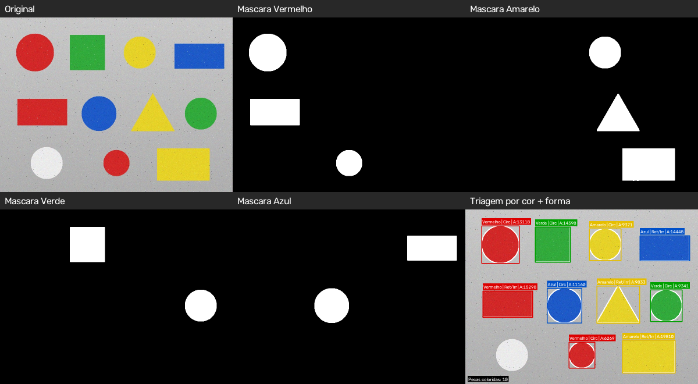

# Atividade Prática – Visão Computacional

Protótipo de sistema de visão que vai do **pré-processamento de baixo nível**
(filtro gaussiano, Otsu, morfologia) à **extração de informação de alto nível**
(contornos, área, perímetro, circularidade, classificação e contagem de
objetos).

## Estrutura

| Arquivo | Conteúdo |
|---|---|
| `parte1_respostas.md` | Parte 1: respostas das Questões 1, 2 e 3 |
| `pipeline_formas.py` | Parte 2: Etapas 1 a 4 (filtragem → Otsu → morfologia → contornos → classificação) |
| `segmentacao_hsv.py` | Parte 3, Desafio A: triagem de peças por cor no espaço HSV |
| `gerar_imagens_teste.py` | Gera as imagens sintéticas de teste |
| `objetos_esteira.jpg`, `pecas_coloridas.jpg` | Imagens de teste geradas pelo script acima |
| `resultados/`, `resultados_hsv/` | Saídas: imagem de cada etapa, painéis, máscaras e `metricas.csv` |

> ⚠️ **As imagens de teste são sintéticas.** O enunciado pede uma foto tirada
> com o celular ou baixada da internet. Para a entrega, rode os scripts com a
> sua imagem (veja as [dicas para a foto](#dicas-para-a-sua-foto)).

## Como executar

```bash
pip install -r requirements.txt

# Parte 2: classificação de formas
python pipeline_formas.py                       # usa objetos_esteira.jpg
python pipeline_formas.py minha_foto.jpg        # usa a sua imagem
python pipeline_formas.py minha_foto.jpg --mostrar           # abre janelas
python pipeline_formas.py minha_foto.jpg --objetos-claros    # objetos claros em fundo escuro
python pipeline_formas.py minha_foto.jpg --regra-melhorada   # ver "Análise crítica"

# Parte 3: triagem por cor (HSV)
python segmentacao_hsv.py                       # usa pecas_coloridas.jpg
python segmentacao_hsv.py minha_foto.jpg
python segmentacao_hsv.py minha_foto.jpg --amostrar 120 80   # HSV do pixel x=120, y=80
```

Outras opções: `--limiar` (padrão 0.78), `--area-minima` (padrão 200 px),
`--largura-max` (padrão 1000 px) e `--saida`. Rode qualquer script com `-h`
para ver todas.

## Parte 2: pipeline e resultados



| Etapa | O que o código faz | Por quê |
|---|---|---|
| 1. Pré-processamento | `cvtColor` → cinza e `GaussianBlur` 5×5 | Atenua ruído de alta frequência (sal e pimenta, granulação) antes da limiarização |
| 2. Binarização | `threshold` com `THRESH_BINARY_INV + THRESH_OTSU` | O limiar é escolhido automaticamente (aqui, T = 135); objetos escuros ficam brancos |
| 2. Abertura | `MORPH_OPEN`, kernel 3×3, 2 iterações | Remove pontinhos brancos isolados (ruído) |
| 2. Fechamento | `MORPH_CLOSE`, kernel 5×5, 2 iterações | Fecha o reflexo no círculo e a rachadura no retângulo |
| 3. Contornos | `findContours(RETR_EXTERNAL)`, `contourArea`, `arcLength` | Mede área, perímetro e circularidade = 4πA/P² |
| 4. Classificação | C ≥ 0,78 → Circular; C < 0,78 → Retangular/Irregular | Desenha o contorno, a caixa delimitadora, a classe e a área |

Contornos com área menor que `--area-minima` são descartados como ruído. Fotos
mais largas que 1000 px são reduzidas, porque em uma foto de 4000 px os kernels
3×3 e 5×5 ficam pequenos demais em relação ao ruído.

**Métricas obtidas** (`resultados/metricas.csv`):

| # | Objeto real | Área (px) | Perímetro (px) | Circularidade | Classe (regra do enunciado) |
|---|---|---:|---:|---:|---|
| 1 | Círculo grande | 17 465,5 | 494,2 | 0,899 | Circular ✅ |
| 2 | Quadrado | 12 098,5 | 438,2 | **0,792** | **Circular ❌** |
| 3 | Triângulo | 11 186,0 | 497,0 | 0,569 | Retangular/Irregular ✅ |
| 4 | Círculo pequeno | 3 115,5 | 208,8 | 0,898 | Circular ✅ |
| 5 | Retângulo (com rachadura) | 19 799,5 | 619,4 | 0,648 | Retangular/Irregular ✅ |
| 6 | Estrela | 8 256,0 | 543,2 | 0,352 | Retangular/Irregular ✅ |
| 7 | Círculo (com reflexo) | 11 114,0 | 392,3 | 0,907 | Circular ✅ |

**Contagem:** 7 objetos, sendo 4 classificados como circulares e 3 como
retangulares/irregulares.

## Parte 3: triagem por cor em HSV



A imagem é suavizada, convertida de BGR para HSV e passada por `cv2.inRange`
com um intervalo (H, S, V) para cada cor. Cada máscara passa pela mesma
abertura e pelo mesmo fechamento da Parte 2 e depois pelas mesmas Etapas 3 e 4.
O resultado é a cor e a forma de cada peça, além da contagem por cor.

| Cor | Intervalos H (0–179) | S mín. | V mín. |
|---|---|---:|---:|
| Vermelho | 0–10 **e** 170–179 | 100 | 60 |
| Amarelo | 20–35 | 100 | 60 |
| Verde | 40–85 | 80 | 50 |
| Azul | 95–130 | 100 | 50 |

**Resultado:** 10 peças coloridas (3 vermelhas, 3 amarelas, 2 verdes e 2 azuis).
A **peça branca foi ignorada de propósito**, porque tem S = 1. A matiz dela é
H = 150, um valor sem significado, já que a matiz é instável quando a saturação
é baixa. Por isso, todas as faixas exigem uma saturação mínima.

Para calibrar com a sua foto, use `--amostrar X Y` sobre algumas peças e ajuste
`FAIXAS_HSV` em `segmentacao_hsv.py`. No OpenCV, H vai de 0 a 179 (os graus
divididos por 2).

## Análise crítica (vale incluir no relatório)

### 1. O quadrado é classificado como "Circular" pela regra do enunciado

Esse resultado é matemático, não um erro do código. Para um quadrado de lado L:

> C = 4π·L² / (4L)² = **π/4 ≈ 0,785**

Esse valor fica **praticamente em cima do limiar de 0,78**. O filtro e a
morfologia arredondam um pouco os cantos, e a circularidade medida sobe para
0,792. A circularidade sozinha, portanto, **não separa quadrados de círculos**.
Para comparação: um retângulo 2:1 tem C ≈ 0,698, um triângulo equilátero
C ≈ 0,605 e um círculo digital, nesta imagem, C ≈ 0,90.

**Melhoria implementada (opcional, `--regra-melhorada`):** o código também
calcula a **retangularidade**, que é a área do objeto dividida pela área do
menor retângulo rotacionado que o envolve (`cv2.minAreaRect`). Ela vale cerca
de 0,785 (π/4) para um círculo e cerca de 1,0 para quadrados e retângulos, e
não muda com a rotação. Com a regra "Circular se C ≥ 0,78 **e** retangularidade
< 0,90", o quadrado passa a ser classificado corretamente, e todos os
7 objetos acertam. A regra do enunciado continua sendo o padrão.

### 2. Efeito de cada etapa de pré-processamento (evidência para a Questão 3)

| Configuração | Contornos encontrados | Objetos contados | Circularidade do círculo grande | Retângulo rachado |
|---|---:|---:|---:|---|
| Pipeline completo | 7 | **7** ✅ | 0,899 | 1 objeto, C = 0,648 |
| Sem fechamento (só a abertura) | 8 | 8 ❌ | 0,899 | **Partido em 2** |
| Sem filtro gaussiano | 7 | 7 | 0,886 | 1 objeto, C = 0,641 |
| Sem filtro e sem morfologia | **1057** | 8 ❌ | 0,868 | Partido em 2 |

Sem o pré-processamento, o ruído vira centenas de contornos falsos. As bordas
serrilhadas aumentam o perímetro e derrubam a circularidade. E a rachadura não
fechada divide um objeto em dois, o que erra a contagem.

### 3. Limitações do protótipo

- O Otsu global assume iluminação razoavelmente uniforme. Com sombras fortes,
  seria preciso limiarização adaptativa (`cv2.adaptiveThreshold`).
- Objetos encostados formam um único contorno. Separá-los exigiria, por
  exemplo, a transformada de distância com *watershed*.
- As medidas estão em pixels. Para ter mm² seria preciso calibrar a câmera com
  um objeto de referência de tamanho conhecido.
- `putText` não desenha acentos, por isso os rótulos na imagem aparecem sem
  acento ("Classificacao").

## Dicas para a sua foto

- **Fundo liso e contrastante:** objetos escuros sobre papel branco, ou objetos
  claros sobre fundo escuro com `--objetos-claros`.
- **Luz difusa**, sem sombras fortes. Luz do dia perto de uma janela funciona
  bem; evite o flash.
- **Celular paralelo à mesa**, para evitar distorção de perspectiva, que
  transforma círculos em elipses.
- **Objetos separados**, sem encostar uns nos outros. Exemplos: moedas, tampas
  de garrafa, borrachas, post-its, dados.
- Se aparecerem objetos falsos pequenos, aumente `--area-minima`.
